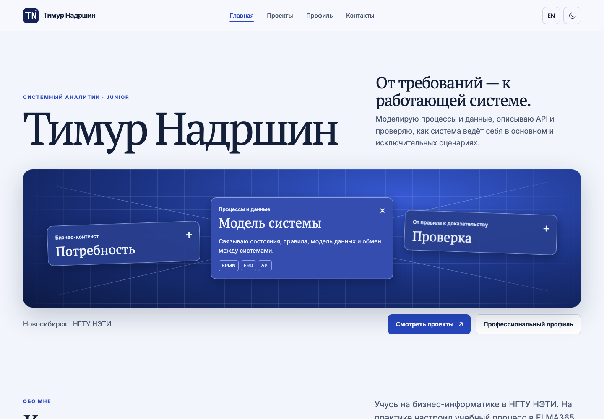

# Timur Nadrshin · System analysis portfolio

[Open the website](https://bivaettttt.github.io/portfolio/en/) · [Русский README](README.md)

A bilingual professional profile, project directory, analysis cases and walkthroughs grounded in repository evidence. Nine independent learning systems sit alongside selected coursework and applied work.

```sh
npm ci
npm run dev
npm run verify
npx playwright install chromium
npm run test:browser
```

Open `http://127.0.0.1:4321/portfolio/en/`. Astro generates static documents under `/portfolio/`. Add a case in `src/content/projects/<category>`; Content Collections validate both languages. GitHub Actions test the static package and publish from `main`.

- [Route and navigation model](docs/information-architecture.md)
- [Evidence inventory](docs/content-evidence.md)
- [Project status](docs/PROJECT_STATUS.md)

Portfolio 2.0 adds an interactive document desk, dimensional folders, chapter navigation, 15 expanded cases and fullscreen original-image inspection. All 30 personal-project captures are shipped as original PNGs. Reconstructed academic and applied diagrams are explicitly labelled.

- [Portfolio 2.0 report](docs/portfolio-2.md)
- [Before/after evidence](docs/evidence/v2/screenshots.md)
- [Media quality](docs/media-quality-audit.md)
- [Verification](docs/testing-results.md)


