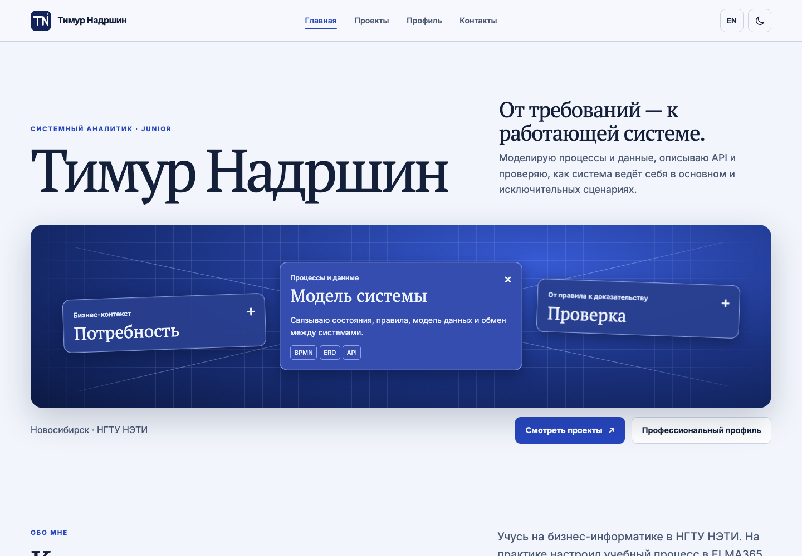

# Тимур Надршин · Портфолио системного аналитика

[Открыть сайт](https://bivaettttt.github.io/portfolio/) · [English README](README.en.md)

Двуязычное портфолио с профессиональным профилем, каталогом, аналитическими кейсами и презентациями фактических результатов. Девять личных систем дополняют выбранные учебные работы и практика.

```sh
npm ci
npm run dev
npm run verify
npx playwright install chromium
npm run test:browser
```

Откройте `http://127.0.0.1:4321/portfolio/`. Astro генерирует статические документы под `/portfolio/`. В `src/content/projects` один проверяемый двуязычный JSON на кейс. GitHub Actions проверяет сборку и публикует артефакт из `main`.

- [Информационная архитектура](docs/information-architecture.md)
- [Дизайн и исследование](docs/design-research.md)
- [Происхождение материалов](docs/content-evidence.md)
- [Статус проекта](docs/PROJECT_STATUS.md)

Portfolio 2.0: интерактивный стол документов, объёмные папки, навигация по главам, 15 расширенных кейсов и полноэкранное исследование оригиналов. Все 30 личных кадров доступны в исходном PNG; реконструкции учебных и практических материалов явно обозначены.

- [Отчёт Portfolio 2.0](docs/portfolio-2.md)
- [Скриншоты до и после](docs/evidence/v2/screenshots.md)
- [Качество медиа](docs/media-quality-audit.md)
- [Тесты](docs/testing-results.md)


